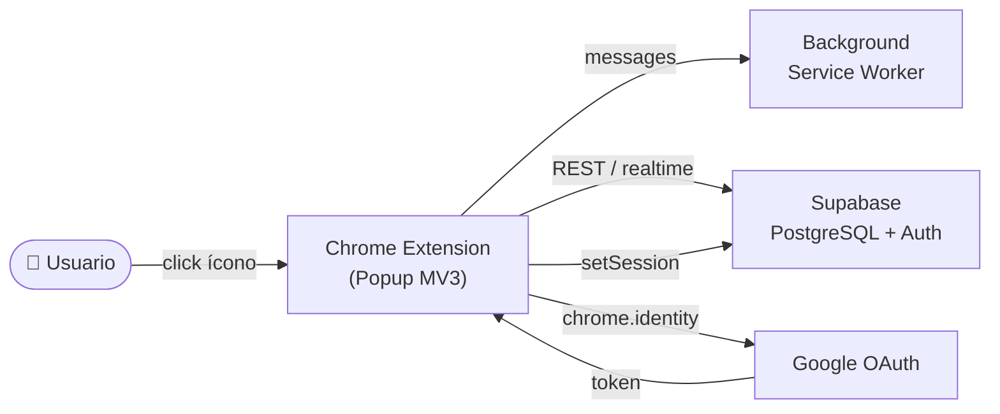
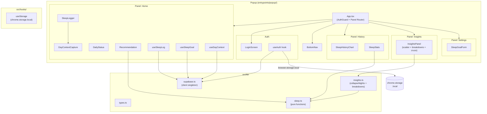
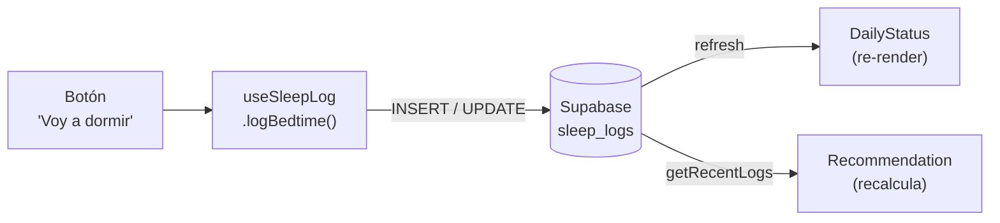

# Diagramas de Componentes

Referencia estructural estable. Actualizar solo si cambia la topología del sistema.

## Contexto (alto nivel)

## Componentes del Popup

## Flujo de Datos — Sleep Log

